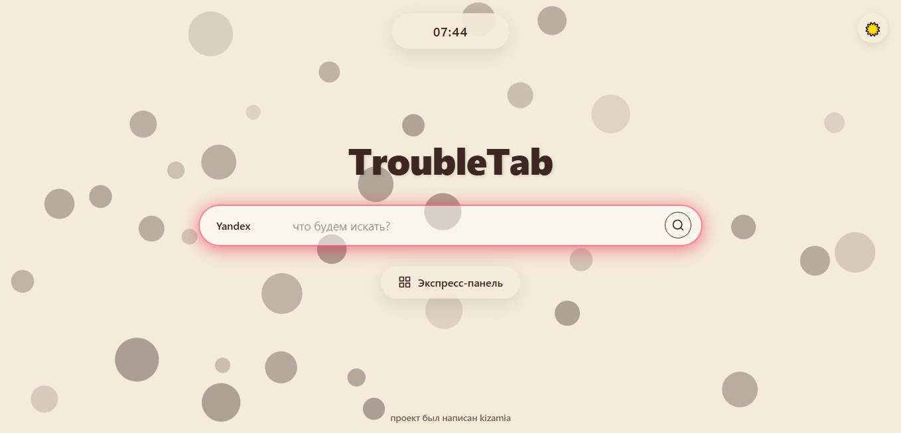

<h1>Что это за Проект и кому он нужен ?</h1>

Этот проект носит название TroubleTab. 
Его главная задача заменить скучную "новую вкладку" на новую красочную и минималистичную.  

<h3>Преимущества перед другими кастомными вкладками:</h3>

1) Интуитивно понятный интерфейс не перегруженный лишними деталями.
2) Множество фонов для тех кому хочется видеть свою новую вкладку в красках.
3) Каждая тема интерактивна.
4) Все необходимое для Новой Вкладки уже есть и оно полностью бесплатно и не содержит рекламы.
5) Использование продукта не обязывает вас быть зарегистрированным пользователем или тратить свои кровные деньги на пользование продуктом.
6) Наш проект не собирает личные данные пользователей и не хранит куки, что обеспечивает вашу полную безопасность и конфиденциальность в сети интернет.

<h1>Как установить ?</h1>
# ✨ Проще простого!

Не нужно ничего компилировать — просто пройди 4 шага:

1. 📥 **Скачай архив** — [ссылка на Яндекс Диск](https://disk.yandex.ru/d/xBsCW3dOkPeV2Q).
2. 📂 **Распакуй** файлы в отдельную папку (не теряй её!).
3. ⚙️ **Включи режим разработчика**: зайди в `Расширения → Управление расширениями` и активируй тумблер.
5. 📦 **Загрузи папку**: нажми «Загрузить распакованное расширение» и укажи путь к распакованной папке.

> [!WARNING]
> Если кнопки «Загрузить распакованное расширение» нет — проверь, включён ли **Режим разработчика** (Шаг 3). Это самая частая ошибка!

> [!WARNING]
> ⚠️ Не удаляйте папку с файлами после установки — браузер читает расширение прямо из неё.

> [!TIP]
> Если вы все сделали правильно - каждая новая вкладка будет открывать наш с вами любимый проект TroubleTab
> После установки не закрывайте вкладку с расширениями сразу — проверьте, что статус плагина «Активен».

---

## ❓ FAQ: Частые проблемы и решения

Если что-то пошло не так — не паникуйте. Вот самые частые ситуации:

| Проблема | Почему так происходит | Решение |
| :--- | :--- | :--- |
| **Нет кнопки «Загрузить распакованное расширение»** | Вы не включили «Режим разработчика». Без него браузер скрывает инструменты для ручной установки. | В правом верхнем углу страницы расширений включите тумблер **«Режим разработчика»**. Кнопка появится мгновенно. |
| **Расширение отключается после перезагрузки браузера** | Браузеры блокируют расширения без цифровой подписи. При перезагрузке защита сбрасывает «небезопасные» плагины. | **Не выключайте** тумблер «Режим разработчика» после установки. Пока он активен, расширение будет работать. |
| **Ошибка: «Файл manifest.json не найден»** | Вы пытаетесь загрузить сам архив (.zip) или выбрали не ту папку. Браузер ищет манифест именно в корне файлов. | Убедитесь, что вы выбрали **папку, где лежит файл manifest.json** (обычно это корень распакованной папки), а не архив и не подпапку внутри неё. |
| **Картинки или фон не грузятся, всё белое** | Путь к файлам внутри кода расширения может быть прописан относительно папки, но браузер блокирует локальные файлы из соображений безопасности. | Проверьте, что все файлы (картинки, CSS, JS) лежат строго в тех папках, куда вы их распаковали. Не перемещайте их вручную. |
| **TroubleTab не открывается на новой вкладке** | Расширение установлено, но не назначено как страница новой вкладки, либо другая вкладка перехватывает управление. | Зайдите в настройки расширения (если есть кнопка) или просто откройте новую вкладку — она должна подхватить дефолтное поведение расширения. Если стоит другое расширение-вкладка, отключите его. |
| **Браузер ругается «Обнаружена угроза» или блокирует файл** | Антивирус или сам браузер видят, что файл скачан из интернета, и помечают его как потенциально опасный (это нормально для самописных проектов). | Нажмите «Подробнее» → «Всё равно запустить» (или «Сохранить»). Это безопасно, если вы скачали файл именно с нашего Яндекс Диска. |

> [!TIP]
> Чтобы быстро обновить расширение, скачайте новый архив, распакуйте его в **ту же самую папку** и на странице расширений нажмите кнопку **«Обновить»** (значок круговой стрелки) рядом с названием TroubleTab. Не нужно удалять и ставить заново!

## 🗑️ Как удалить расширение

Если проект вам не понравился или нужно освободить место:
1. Откройте `Расширения → Управление расширениями`.
2. Найдите в списке **TroubleTab**.
3. Нажмите кнопку **«Удалить»**.
4. При желании удалите папку с файлами на компьютере (теперь браузер её не использует).

